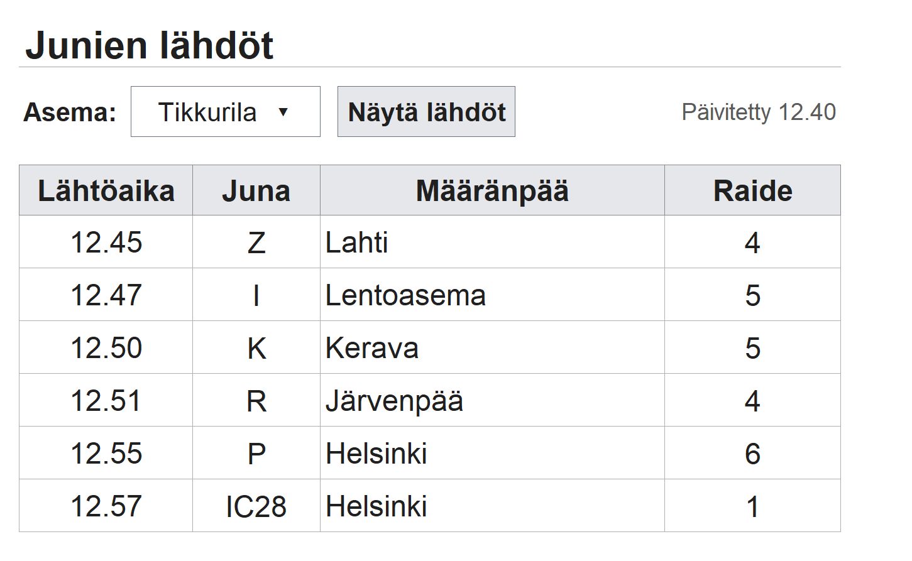
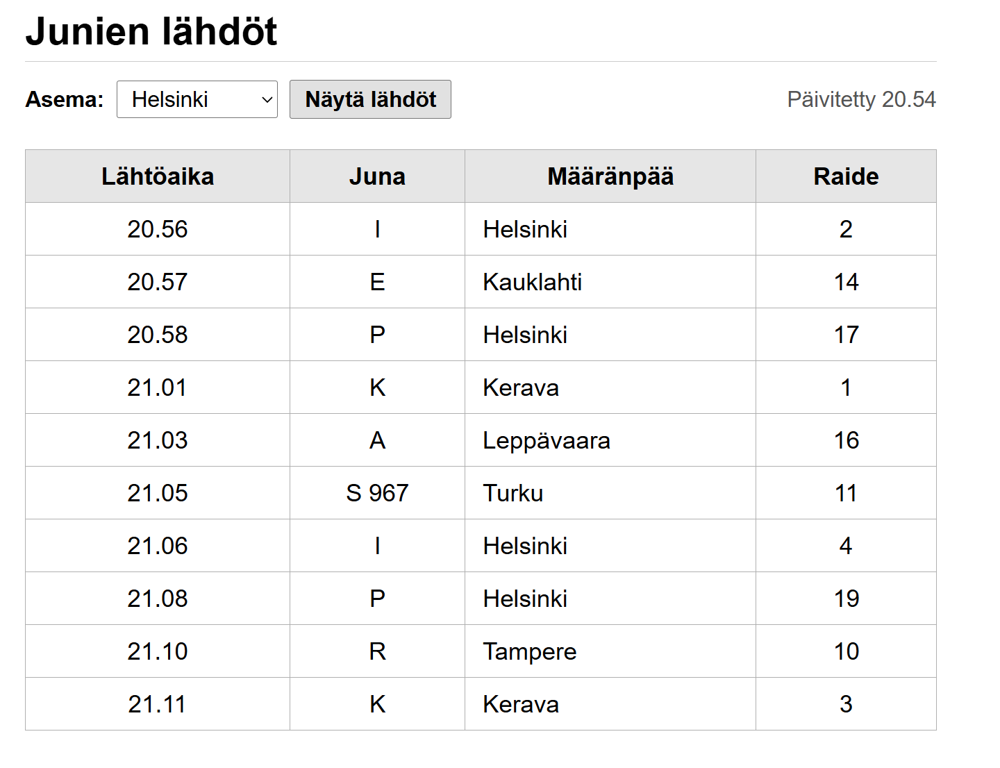

# Junalähdöt sovellus

**Tekijä(t):** Eetu Pyykkö & Emil Salmenkylä

## Projektisuunnitelma

### Projektin idea

Junalähdöt sovellus projektin ideana on päivittyvä taulukko, joka hakee Digitraffic API:lla valitun juna-aseman lähtevien junien tiedot.

### Suunnitellut toiminnot

- Kellon aika, jotta käyttäjä voi verrata tämän hetkistä aikaa junan lähtöaikaan
- Asema valitsin, voi valita miltä juna-asemalta tiedot haetaan
- Automaattinen taulukon päivitys minuutin välein

### Rautalankamalli / luonnos

## Verkkolinkit

- **Julkaistu sovellus:** [https://gtg4m3r.github.io/Projekti_2/](https://gtg4m3r.github.io/Projekti_2/)
- **GitHub-repositorio:** [https://github.com/GTG4M3R/Projekti_2](https://github.com/GTG4M3R/Projekti_2)

## Tietoja sovelluksesta

**[Junalähdöt]** on verkkosovellus, josta käyttäjä voi seurata junien tietoja. Käyttäjä voi valita neljästä asemasta: Helsinki, Pasila, Tikkurila ja Leppävaara, jonka jälkeen hän näkee Junan X lähtö kellonajan, raiteen ja määränpään.

## Teknologiat

## Teknologiat

### HTML – sivun rakenne
HTML muodostaa sivun rakenteen: aseman valinnan, hakupainikkeen ja lähtötaulukon. Taulukossa näytetään junan lähtöaika, tunnus, määränpää ja raide.

### CSS – ulkoasu ja asettelu
CSS määrittää sivun värit, fontit, välit ja taulukon ulkoasun. Responsiivinen asettelu mukauttaa näkymää puhelimelle ja suuremmalle inforuudulle.

### JavaScript – toiminnallisuus ja DOM-skriptaus
JavaScript hakee valitun aseman junatiedot Digitrafficin REST API:sta ja järjestää lähdöt aikajärjestykseen. Tiedot lisätään taulukkoon DOM-skriptauksen avulla. JavaScript hoitaa myös automaattipäivityksen minuutin välein, päivitysajan näyttämisen ja hakujen virheilmoitukset.

## Sovelluksen käyttö

Kirjoita lyhyet käyttöohjeet sovellukselle.

1. Avaa julkaistu sovellus yllä olevasta linkistä.
2. Valitse alasveto valikosta haluttu juna-asema.
3. Paina "Näytä lähdöt" -painiketta.
4. Sivulla tulisi nyt olla valitun juna-aseman tiedot. Sivu päivittyy automaattisesti minuutin välein.

## Sovelluksen käynnistäminen paikallisesti

1. Kloonaa tai lataa tämä repositorio omalle koneellesi.
2. Avaa projektikansio.
3. Avaa `index.html` selaimessa.

## Kuvakaappaukset

## Tunnetut virheet / puutteet

**Ei tunnettuja virheitä.**

## Työn jakautuminen

Työn jakautuminen ja yhteistyö.

- Tekijä 1: Eetu Pyykkö
  - Rautalankamallin suunnittelu
  - JavaSript: kello, "Näytä lähdöt" napin toiminnallisuus, juna tunnusten ja lähtöaikojen haku Digitrafic API:sta
  - README.md pitkälti

- Tekijä 2: Emil Salmenkylä
  - Index html ja CSS aloitus rautalankamallin perusteella
  - Määränpäät ja raiteiden haku Digitrafic API:sta
  - Automaattinen sivun päivitys minuutin välein

Yhteistyö sujui ongelmitta. Sovittiin, kuka tekee mitäkin. Olimme kokoajan yhteydessä toisiin Discordin välityksellä, vaikka sovimme työnjaon. Kysyimme toisen apua ja mielipidettä lähes aina ennen commit. Kommunikointi auttoi myös siinä, etteivät molemmat olleet muokkaamassa samaa tiedostoa samaan aikaan.

## Oma arvio ja oppimisen reflektointi

- **Missä onnistuin?** Sain API-haun toimimaan ja junien lähdöt selkeään taulukkoon.
- **Mikä oli haastavaa?** API-datan käsittely ja oikeiden lähtötietojen poimiminen.
- **Mitä parantaisin?** Lisäisin hakukentän ja testaisin sivua useammalla laitteella.
- **Mitä opin?** HTML:n rakennetta, CSS:n responsiivisuutta, JavaScriptin API-hakuja ja taulukon päivittämistä DOM:n avulla.
- **Mistä haluaisin oppia lisää?** API-hakujen ajoituksesta ja virheenkäsittelystä.
- **Oma arvio projektista: 8/10 pistettä.**

## Lähteet ja kiitokset

## Lähteet

- [MDN: Kellonaikojen muotoilu – toLocaleTimeString()](https://developer.mozilla.org/en-US/docs/Web/JavaScript/Reference/Global_Objects/Date/toLocaleTimeString)
- [MDN: Ajastin – setInterval()](https://developer.mozilla.org/en-US/docs/Web/API/Window/setInterval)
- [MDN: Tekstin korvaaminen – replace()](https://developer.mozilla.org/en-US/docs/Web/JavaScript/Reference/Global_Objects/String/replace)
- [MDN: Olion ominaisuuksien käsittely](https://developer.mozilla.org/en-US/docs/Web/JavaScript/Reference/Operators/Property_accessors)
- [MDN: OR-operaattori ja vara-arvot](https://developer.mozilla.org/en-US/docs/Web/JavaScript/Reference/Operators/Logical_OR)
- [Digitraffic API](https://www.digitraffic.fi/en/railway-traffic/)

### Tekoälyn käyttö
- Projektissa käytettiin ChatGPT, Gemini ja GitHub Copiloti tekoälyjä toteutustapojen pohtimiseen, koodin toiminnan ymmärtämiseen ja virheiden selvittämiseen. Apua pyydettiin erityisesti JavaScriptin API-hakuihin, kellonaikojen käsittelyyn ja automaattipäivitykseen. Tavoitteena oli saada vaikeisiin kohtiin ymmärrettäviä ohjeita, joita pystyttiin soveltamaan projektissa.

  ## Lisenssi

Tämä projekti on lisensoitu MIT-lisenssillä.

Lisätietoa lisenssin lisäämisestä GitHub-projektiin:
https://docs.github.com/en/communities/setting-up-your-project-for-healthy-contributions/adding-a-license-to-a-repository